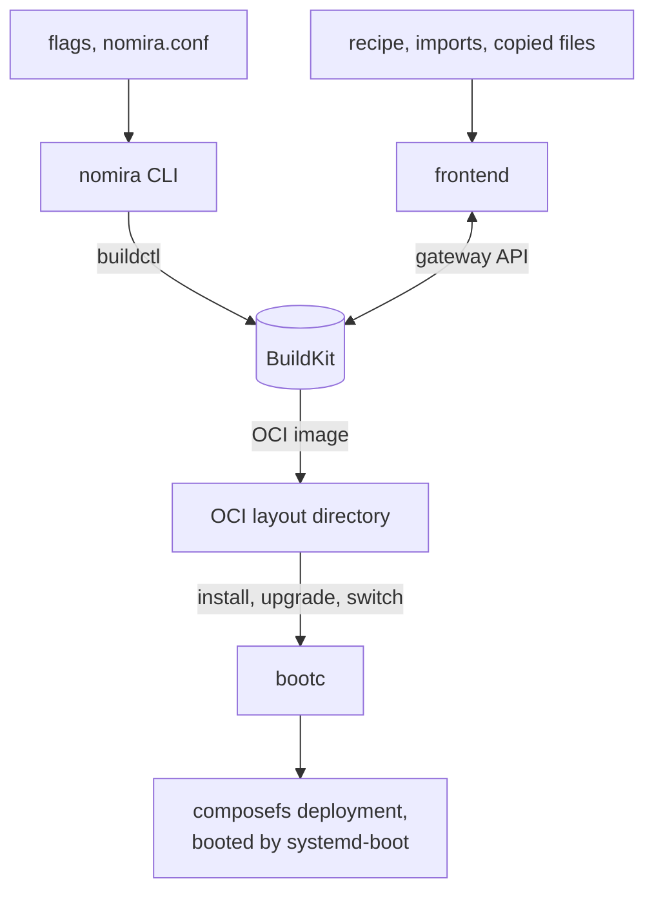

## Components

The arrows are the only interfaces: the recipe for the frontend, the
[gateway API](https://github.com/moby/buildkit/blob/master/frontend/gateway/pb/gateway.proto)
between frontend and BuildKit, buildctl's options for the client, and an
OCI image for bootc. The directory is `/var/lib/nomira/<name>.oci` for
the machine's own recipe.

## Maxims

| Part | Maxim |
|---|---|
| Recipe | Describes the system completely, as far as a frontend can act on it. Whatever only a BuildKit client can set is not in it. |
| Frontend | Independent, modular, and fast through one rule of thumb: `run` in stages and collectors, copies in groups. It knows no package manager, no CLI and no distribution. |
| BuildKit | Used unchanged: it executes, caches and exports. nomira adds no daemon, plugin or patch. |
| CLI | A thin client that finds a buildkitd, passes the client options and publishes only images that passed their checks. It never changes the running system. |
| Base image | The smallest Arch Linux that bootc boots, reproducible to the byte. Everything specific to Arch lives here and nowhere else. |
| bootc | Deploys: updates, rollbacks and installation are bootc's. |

## Rules that hold across all parts

- **Client options are not recipe settings.** What has to be an option of
  the BuildKit client (exporter, compression, image name, sources of
  secrets, pull policy) is a flag or a line in
  [nomira.conf](../cli/commands/#nomiraconf), never a recipe setting.
- **Loose coupling.** The CLI knows the frontend only as an image that
  BuildKit runs, and reads the labels it writes; the frontend never reads
  anything of the CLI. Versions are compared, never required: see
  [Versions](client/#versions).
- **Builds are reproducible.** The same recipe on the same base image
  gives the same layers: see [Reproducibility](build/#reproducibility).
- **The image holds no machine state.** A recipe mounts a tmpfs or a
  cache where builds write logs, caches and temporary files, so they end
  up in no layer: see [Mounts](mounts/).
- **The base image carries no recipe.** Parts for recipes are imported
  by URL; the image never assumes them.
