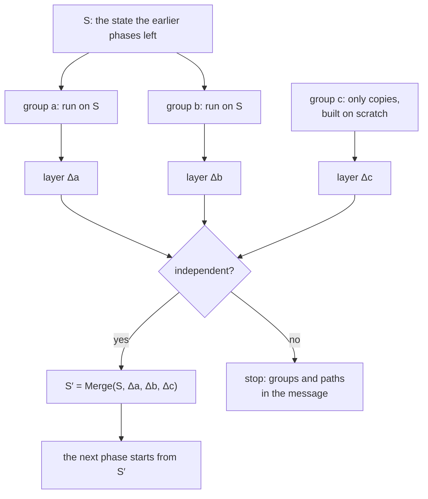

## Recipe to LLB

The frontend runs as a BuildKit
[gateway frontend](https://docs.docker.com/build/buildkit/frontend/):
BuildKit starts its image (`# syntax=` or `--frontend gateway.v0`), the
frontend reads the recipe through the gateway, builds an
[LLB](https://github.com/moby/buildkit#exploring-llb) graph and asks
BuildKit to solve it.

1. **Load.** The entry file, then every file it imports, one by one; an
   import by URL BuildKit fetches itself. From the build context only
   the paths `copy` names. Nothing else leaves the client.
2. **Merge.** [Imports](../../recipes/imports/) are merged as JSON Merge
   Patch into one document, the resolved recipe.
3. **Parse.** Strict: unknown keys are errors, with file and line.
   Collectors get their items. With the build option `mode=lint` or
   `mode=resolve` the frontend stops here and answers.
4. **Compile.** Phase by phase, with real results in between (see below).
5. **Export.** BuildKit's exporter writes the image. Its options come
   from the client; the frontend contributes the image config, the epoch
   and the base config (see [Client](../client/)).

## Phases, groups, collectors

| Element | LLB | Cache key depends on |
|---|---|---|
| Phase | the state `S` all its groups start from | everything before it |
| Group with `run` | `Exec` on `S`, then `Diff(S, result)` | `S` and the group's commands |
| Group without `run` | built on `scratch`, merged as is | only the group's commands and copied files |
| Merge of a phase | `Merge(S, Δ₁ … Δₙ)` ([MergeOp](https://github.com/moby/buildkit/blob/master/docs/dev/merge-diff.md)) | the layers merged |
| Collector | a group with one `Exec` on `S` with `${items}` | `S` and the sorted items |
| Collector that fans out | `resolve`, one `Exec` per bucket on `S`, `then` | per bucket: `S` and the bucket's files |
| Stage | its own `Image` | its base and commands |

A phase with a single group that runs is serial: no diff, no merge, no
check. Every layer of a merge stays a layer of the image, so an
unchanged group is neither exported nor downloaded again.

## Checks during the build

These steps mount whole systems read-only and are named `[check …]` in
the output.

- **Conflicts.** For a phase with several groups, small steps list what
  each group wrote and deleted and hash what several groups wrote; the
  frontend compares the groups. A conflict stops the build before
  anything is merged on top of it. See
  [The conflict check](../conflict-check/).
- **Buckets.** Between the buckets of a collector that fans out, the
  first pass of the same check runs strictly: a file in two buckets is a
  conflict, even with the same content.
- **Guard.** A group without `run` is only built on `scratch` when
  merging provably gives the same tree as building it on `S` (no
  symbolic links, modes or types in the way). Otherwise it falls back,
  with a warning in the step names; see
  [Checked, not assumed](../../recipes/rebuilds/#checked-not-assumed).

The build option `check=off` (`nomira build --no-check`) skips the checks
between groups and between buckets; the guard stays.

## A collector that fans out

`resolve` runs first and is solved at once: the frontend needs its list
to build the rest of the graph. Then everything that does not wait for
something else runs side by side: BuildKit fetches the files, and every
bucket whose files are there runs `each` on `S`. No bucket waits for
another, and an unchanged bucket comes from the cache. `then` waits for
all of them, and the later phases wait for `then`.

A file's bucket depends on its key alone, by rendezvous hashing over 64
buckets: adding or removing a file changes only its own bucket. Every
bucket starts from `S`, so a change before the collector (a new base
image, an earlier phase) runs all buckets again. The steps in order:
[Collectors that fan out](../../recipes/collectors/#collectors-that-fan-out).

## Cache keys

BuildKit keys a step by its definition and its inputs. For read-only
bind mounts it would by default checksum every file of the mounted tree
([content-based cache](https://github.com/moby/buildkit/blob/master/solver/llbsolver/ops/exec.go));
the frontend turns that off for bind mounts and checks, since the
definition of the mounted phase identifies it as well and a whole system
takes seconds to checksum. Cache mounts, tmpfs and secrets never enter a
key. A file a collector fetches is keyed by its sha256, so the same
package is downloaded once, whatever its URL.

## Reproducibility

| Source of difference | Handled by |
|---|---|
| File times in layers | client: `rewrite-timestamp=true` clamps them to the epoch |
| Image creation time | frontend: config `created` is the epoch |
| Tools reading the time (dracut, …) | frontend: `SOURCE_DATE_EPOCH` in every `run` |
| Logs, caches, temp files | recipe: `settings.mounts`, a tmpfs there |
| pacman install dates | base image: a pacman hook sets them to the epoch |
| Package versions | base image: the mirrorlist points to a dated archive snapshot |

The epoch is `settings.source_date_epoch`, by default the creation time
of the base image. The base image itself is checked by building it twice
without cache and comparing all layers.

## The record

The resolved recipe is written to the image's label `org.nomira.recipe`.
A label belongs to the config, so it is covered by the image digest and
its signature but is no layer: a change to the recipe alone rebuilds no
step. `nomira recipe export` and `diff` read it.
