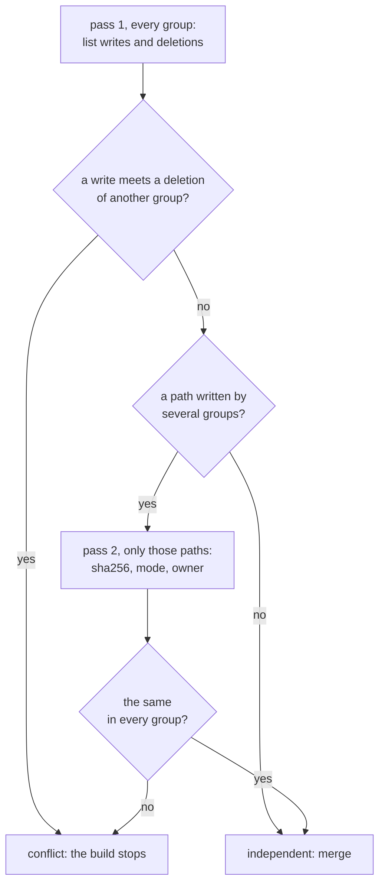

The groups of a phase are built side by side, each on the state `S` the
phase starts from, and their layers are merged:
`S' = Merge(S, Δ₁ … Δₙ)`. That is only right if the result is the same
as running the groups one after the other, in any order. The conflict
check verifies this on every build, for every phase with more than one
group, before anything is merged on top of it or exported.

## What a group changes

| Change | Found in | Recorded as |
|---|---|---|
| A file or symbolic link written | the group's layer `Δ`, the files the merge lays on top | a write |
| A file or symbolic link deleted | the trees before and after the group, walked by name | a deletion |
| A directory deleted | the same | a deletion with everything below it |

Every file in the layer counts as written, also one the group rewrote
with the same content: its layer would still cover what another group
writes there. Directories that several groups create are never a
conflict. A group without `run` is built on an empty state and cannot
delete anything; only its layer is listed.

## What is allowed

Exactly what is the same in every order:

| Both groups | Result |
|---|---|
| write a path, same content, mode and owner | allowed |
| delete the same file, or the same directory | allowed |
| one deletes a directory, the other something below it | allowed |
| write a path differently (content, mode or owner) | conflict |
| one writes a path, the other deletes it | conflict |
| one writes below a directory the other deletes | conflict |
| one has a file, the other deletes a directory of that name | conflict |

There is no allowlist and no policy to choose. Two groups that write the
same file differently depend on their order, and an order belongs in the
recipe: make them one group, or move one into a phase of its own. The
error says which groups and which paths:

```text
phase "features": its groups are not independent:
  groups "network" and "wifi": /etc/NetworkManager/conf.d/dns.conf (both write, with different content, mode or owner)
  fix: make it one group, or move one of them into a phase of its own
```

A typical case: two groups that both run `pacman -S` both write pacman's
database. That is what [collectors](../../recipes/collectors/) are for.

## How it runs



Two passes, each a small step per group in a busybox image
([`toolbox`](../../frontend/schema/#build-options)) that mounts the trees
read-only, named `[check …]` in the build output:

1. **List** ([`lister.sh`](https://github.com/Nomira-OS/nomira/blob/main/internal/compile/lister.sh)):
   one `find` per tree and a `comm` of the sorted lists; no file is read,
   no process is started per file. The result: the writes and deletions
   of the group.
2. **Hash** ([`hash.sh`](https://github.com/Nomira-OS/nomira/blob/main/internal/compile/hash.sh)):
   only for the paths that more than one group writes, and only in those
   groups: the sha256 of the content (of the target, for a symbolic
   link), mode and owner. Usually there are none, and the pass does not
   run.

The comparison itself happens in the frontend
([`internal/conflict`](https://github.com/Nomira-OS/nomira/tree/main/internal/conflict)).
Both passes are cached like any other step: they run again only when the
group or the state before it changed. The mounts carry no content-based
cache key, so BuildKit does not checksum the trees
(see [Cache keys](../build/#cache-keys)).

A phase with a single group that uses `run` has nothing to compare: it
skips the check, the diff and the merge.

## Buckets, and turning it off

The buckets of a [collector that fans out](../../recipes/collectors/#collectors-that-fan-out)
are checked strictly, with pass 1 alone: a file in two buckets is a
conflict even with the same content, since two packages that ship the
same file are an error of their own. On arch-base, pacman compares the
packages within a bucket in `each`, and `each` the bucket against the
system it runs on; between buckets only this check does, since `then`
runs with `--overwrite '*'`, and pacman then installs two packages with
the same file without a word (tried with pacman 6.0.2).

`nomira build --no-check` (build option `check=off`) skips both, the
check between groups and the one between buckets. The build gets faster
by these steps; overlapping groups and buckets are then merged in a
fixed order without a word.

## Limits

- Extended attributes and hard links are not recorded as writes of their
  own.
- Paths that contain a newline are not supported.
- Only regular files and symbolic links count; whatever a snapshotter
  leaves in a layer to mark a deletion is ignored, deletions come from
  walking the trees.
