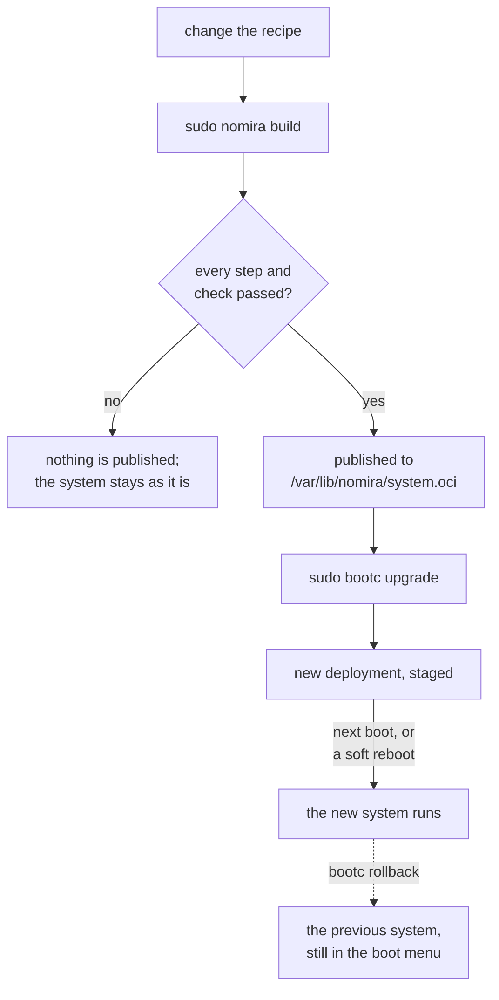

## Updating your own system

```sh
sudo nomira build
sudo bootc upgrade
```



`nomira build` builds the recipe, checks the result and only then
publishes it; nothing changes on the running system. `bootc upgrade`
takes the new image. It takes effect on the next boot; with `--apply`
the machine reboots right away.

## Without a full reboot

When kernel, initramfs and kernel arguments stay the same, bootc can
switch to the new image with a soft reboot: systemd stops and starts
userspace on the new system, the kernel keeps running.

```sh
sudo bootc upgrade --apply --soft-reboot=auto
```

With a [unified kernel image](../../recipes/base-images/boot/#unified-kernel-image)
that is the case whenever no package changed what goes into the
initramfs: it is then either not rebuilt at all or rebuilt to the same
bytes. If a soft reboot is not possible, `auto` does nothing on the
composefs backend instead of rebooting; `sudo reboot` then.
`bootc status --verbose` shows whether the staged image can be
soft-rebooted into.

## Getting newer packages

The package set depends on the base image. Enter a newer tag in
`settings.base` and upgrade. All packages, including those from your
recipe, then come from the newer set; see
[Tags and package set](../../recipes/base-images/arch-base/versions/).

## Back to the previous state

bootc keeps two systems: the one running and the one before it, plus a
new one waiting for the next boot. A new `upgrade` or `switch` replaces
only the waiting one, never the running one; after a reboot the one
that was running becomes the previous one. You can select it in the
boot menu; to go back permanently:

```sh
sudo bootc rollback
```

## What is kept

`/usr` comes entirely from the new image. Your changes in `/etc` stay and
are merged with the new image; `/var` and `/home` stay unchanged. In
detail: [What an update changes](../../architecture/deployment/#what-an-update-changes).
