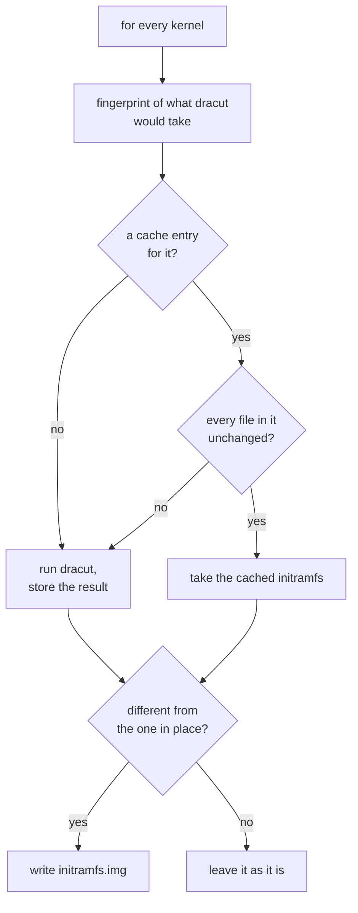

The layout every base image shares, `/usr`, `/etc` and `/var`, is on
[Base images](../../#where-files-belong).

## pacman

- The package database is in `/usr/lib/sysimage/lib/pacman`, not in
  `/var`, so that it is part of the image.
- Cache and log are where Arch has them, in `/var/cache/pacman/pkg` and
  `/var/log/pacman.log`. A recipe keeps both out of the image with
  [`settings.mounts`](../../../../frontend/schema/#settings): a tmpfs at
  `/var/log`, and a cache at `/var/cache/pacman/pkg` that keeps the
  downloads of a `pacman -S` across builds. `mounts.yml` does that.
- `pacman.conf` has no `NoExtract` lines: packages are installed whole,
  documentation, man pages and translations included, as on Arch itself.
  A recipe that wants less adds `NoExtract` lines in a phase before
  `packages`.
- The image ships no pacman keyring, because a keyring holds a private
  key that would then be the same on every machine. A step that checks
  signatures sets one up in a tmpfs from `archlinux-keyring`, as
  `packages.yml` does.
- The mirrorlist points to the day of the Arch Linux Archive the image
  was built from, so `pacman -S` installs from the same package set; see
  [Tags and package set](../versions/).

### Installing packages

Two flavours of the same collector:

| Part | Packages from | Same recipe, same packages |
|---|---|---|
| `packages.yml` | the archive snapshot of the image | yes, on every build |
| `packages-live.yml` | the live repositories, resolved on every build: new packages and every update from one current state | only for the same state of the repositories, which the sync databases in the image record |

`packages-live.yml` imports `packages.yml` and replaces its `resolve`;
import it after `services.yml`. It is the way to a security fix without
waiting for a new base image. Arch does not sign its sync databases, so
a mirror could hold back updates; a package that Arch did not sign it
cannot slip in, since `then` checks every signature.

Install packages with a [collector](../../../collectors/): two groups that
each call pacman would both write the package database and conflict.
`packages.yml` is that collector, one that fans out:

| Step | What pacman does there |
|---|---|
| resolve | `pacman -Sp --needed --print-format '%n %l sha256:%h %e'`: the packages to install with their dependencies, URL, sha256 and pkgbase as the key, so that split packages share a bucket |
| each | `pacman --root /nomira/out -U --nodeps --noscriptlet`: the files of one bucket's packages, with `NoExtract` and file capabilities, and no hook; then a check against the system |
| then | `pacman -Su --needed` with the items, the downloaded files as its cache and downloading forbidden, with `NoExtract = *` and a `!` where a hook needs a path: signatures, database, install scripts and hooks as in a normal install |

- **No hooks in `each`.** libalpm looks for hooks below `--root`, so the
  hooks of a bucket's own packages would run in a system that holds
  nothing but that bucket. Their hook files stay under `NoExtract`
  while pacman runs and are unpacked afterwards, with bsdtar; a tmpfs
  hides `/etc/pacman.d/hooks`.
- **Files again only where a hook needs them.** libalpm ignores files
  under `NoExtract` for path triggers, so `then` negates what the hooks
  in effect trigger on. A hook without `NeedsTargets` needs a single
  matching path: for a target like `usr/share/fonts/*` that is the
  directory `usr/share/fonts/`, which every package with fonts lists, so
  no font is written twice. A hook with `NeedsTargets` gets its targets
  as they are, for `texinfo` the info pages. depmod and the initramfs run
  as their own hooks, as on Arch.
- **Conflicts as pacman finds them.** pacman compares the packages of
  a bucket with each other in `each`; after that, `each` checks the
  bucket against the system it runs on: a file that is there already
  must belong to the package being upgraded, or the bucket stops with
  the file and its owner. The frontend compares the buckets. `then`
  needs `--overwrite '*'` only because the buckets have put the files in
  place before pacman knows them; without it, pacman refuses every one
  of them.
- **Updates like new packages.** `resolve` lists what `pacman -Su
  --needed` would download, so an installed package that the sync
  database has in a newer version comes along. Its bucket lays it over
  the old files; `then` upgrades it in the same transaction, with
  `NoUpgrade = *` next to `NoExtract = *`, so that pacman does not remove
  the old files it would not unpack again, and removes afterwards the
  files only the old version had. Install scripts and hooks see a real
  upgrade, and nothing is written twice.
- **Signatures checked by pacman.** `then` installs with `pacman -S`
  from the downloaded files, so pacman checks every package against its
  signature, with a keyring set up in a tmpfs and no keyserver. pacman
  wants a `.sig` file next to a cached package; `then` writes them from
  the signatures in the sync database (`%PGPSIG%`), and
  `XferCommand = /bin/false` keeps pacman from downloading anything. A
  package signed by an unknown key, or missing from the downloads, stops
  the build. Install reasons are those of `pacman -S` (`then` gets the
  items for that). The frontend knows nothing of signatures: they are
  part of the recipe part, like everything else about pacman.
- **Compared with a normal install** (pacman 6.0.2, packages made for
  the test, a shell in one bucket): the same hooks with the same
  targets, the same files and database; written twice were only the
  files of a `NeedsTargets` hook and a kernel image a hook names by file.
  Not yet measured in a real build.
- **Downloads** are BuildKit's: kept below `/var/lib/buildkit` by their
  sha256, across reboots and base images, until BuildKit's garbage
  collection removes them. `resolve` uses an empty pacman cache only so
  that pacman prints URLs. Without that cache, `nomira build` takes the
  unchanged buckets from the last image or from `--cache-from`, see
  [Reusing what was built](../../../rebuilds/#reusing-what-was-built);
  `then` needs every package and downloads them again.
- **A package that conflicts with an installed one**, such as
  `iptables-nft` with `iptables` in the base image, stops the build in
  `resolve`: `--noconfirm` answers pacman's question with no. Remove the
  installed one first, with `pacman -Rdd` in a phase before `packages`.

## The initramfs

Arch's own dracut hooks write a host-specific initramfs to `/boot`,
which bootc does not boot. The image masks them and installs one pacman
hook with the same triggers, collected from those hooks when the image
is built:

| Triggered by | Like on Arch |
|---|---|
| a kernel package | yes |
| firmware, microcode, dracut and its modules, anything Arch's hooks name | yes |
| any other package | no rebuild |

The hook runs `/usr/lib/nomira/initramfs`, which writes
`/usr/lib/modules/<kver>/initramfs.img` for every kernel and removes it
with its kernel. dracut runs with the image's configuration in
`/usr/lib/dracut/dracut.conf.d`: `hostonly=no`, `reproducible=yes`,
zstd, and the modules `bootc`, `systemd-cryptsetup` and `tpm2-tss`, so
that the initramfs can unlock an encrypted root partition with a TPM.
The frontend sets `SOURCE_DATE_EPOCH` for every step, so the same files
give the same bytes.

### Without running dracut again

`then` runs over all packages of the collector whenever one of them
changes; with the kernel, firmware or dracut among them, the hook runs
every time. dracut does not have to: with a cache mount at `/var/cache/nomira/initramfs`
([`mounts.yml`](https://github.com/Nomira-OS/arch-base/tree/main/recipes)
sets it), the script keeps every initramfs it built and takes one again
when nothing it would contain has changed:



The **fingerprint** covers the kernel version, `SOURCE_DATE_EPOCH`,
dracut's configuration by content, and path, size, mtime, mode and
owner of every file below `/usr/lib/modules/<kver>`, `/usr/lib/firmware`
and `/usr/lib/dracut`, and of the configuration in `/etc` that dracut
takes (`vconsole.conf`, `locale.conf`, `modprobe.d`, `sysctl.d`,
`systemd/*.conf`, `udev/rules.d`, …). The **check** compares path,
size, mtime, mode and owner of every file the cached initramfs contains,
binaries and libraries included.

The result is the same initramfs that dracut would build, byte for
byte. Checking costs a `stat` over some thousand files, well under a
second; dracut takes from 20 seconds to a minute. An initramfs that is
already in place unchanged is not written again, so it does not end up
in the step's layer a second time.

The cache lives with BuildKit's other caches below `/var/lib/buildkit`
on the build machine, so it survives reboots and image updates. The
script keeps the eight newest entries. Without the cache mount it runs
dracut every time and stores nothing, since a cache must never end up in
the image.

### Configuration copied by the recipe

Configuration that belongs into the initramfs, the keymap in
`/etc/vconsole.conf` or a file in `/etc/dracut.conf.d`, triggers no
package hook. The recipe part `initramfs.yml` runs the script once more
in a late phase, after `services.yml` and before `lint.yml` and
`uki.yml`; when nothing changed, it takes the initramfs that is already
there.

```yaml
imports:
  - …/recipes/services.yml
  - …/recipes/initramfs.yml   # after the configuration is in place
  - …/recipes/lint.yml
  - …/recipes/uki.yml
build:
  packages: {}
  features:
    keymap:
      - copy files/vconsole.conf /etc/vconsole.conf
```

The same initramfs serves both ways to boot, see
[Booting](../../boot/#two-ways-to-boot).

## Flatpak

`flatpak` is installed, with Flathub as a remote. Applications and their
runtimes live in `/var/lib/flatpak` (system-wide) or in the user's home,
so they are not part of the image and survive every update; `flatpak
update` updates them independently of the system. A recipe should not
install Flatpak applications: anything it puts below `/var` never
reaches an installed machine.

## Reproducible layers

pacman's install dates become `SOURCE_DATE_EPOCH` (a hook in the image;
the frontend sets the variable for every step), logs never reach a layer
with the mounts above, and the nomira CLI clamps the file times of every
layer to the same time. The same recipe on the same base image thus
gives the same layers, wherever it is built. The time is
[`settings.source_date_epoch`](../../../../frontend/schema/#settings), by
default the creation time of the base image.

## Building on the machine

`buildkit.socket` is enabled. buildkitd runs as root and only on demand:
it starts when `sudo nomira build` talks to it. The image has no
container runtime, so `nomira build` without root has no buildkitd to
fall back to.
