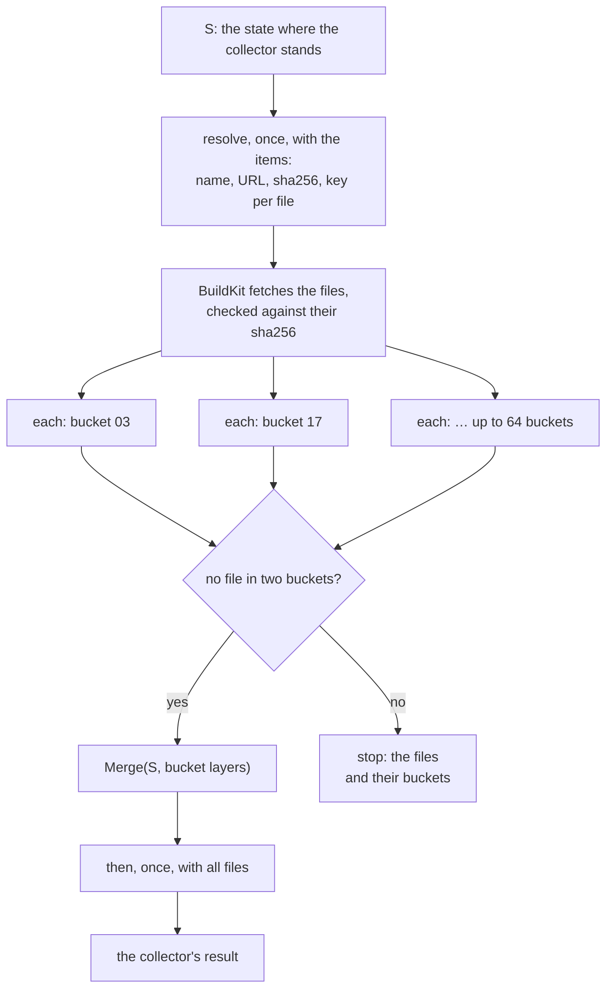

## The problem they solve

Some things have to happen in one step. Two groups that both install a
package both write the package database, so they can never be
independent. Without collectors, a feature would be torn apart: its
package in one phase, its files in another, its service in a third.

## How they work

A group with `collect` is a collector. It runs one command. `${items}`
in that command is replaced by everything the groups of the recipe
contributed under the collector's name. A phase that is one collector
can say so in short: `collect` directly under the phase, and the
collector is named after the phase.

```yaml
build:
  features:
    terminal:
      services: [kmsconvt@tty1.service]
      commands:
        - copy files/kmscon/ /etc/kmscon/
    ssh:
      services: [sshd.service]
  services:
    collect: run systemctl enable ${items}
```

This runs `systemctl enable kmsconvt@tty1.service sshd.service` once,
after the phase `features`.

- **nomira knows nothing about the command.** A collector is whatever
  command you write: install packages, enable services, generate
  locales, add users.
- **Where the collector stands decides when it runs.** Contributions
  come from groups of any phase, also from later ones.
- **The order of items is fixed.** They are sorted and duplicates are
  removed, so moving a group to another file changes nothing.
- **A collector without items is skipped.**
- **Names are unique.** Contributions name the collector, so two
  collectors cannot share a name, wherever they stand.
- **Several in one phase** run side by side, as groups do, and are
  checked like them: they must not change the same files differently.

## What an item may be

A single word of letters, digits and `@%+=:,./_-` that does not start
with `-`. Anything else is an error before the build starts. This keeps
a contribution from changing the meaning of the command.

## Useful collectors

```yaml
build:
  setup:
    services:
      collect: run systemctl enable ${items}
    locales:
      collect: run for l in ${items}; do echo "$l UTF-8" >> /etc/locale.gen; done && locale-gen
```

For packages, take the base image's part: on arch-base
[`packages.yml`](https://github.com/Nomira-OS/arch-base/tree/main/recipes),
a collector that fans out (below). `services.yml` is the collector
`services` above.

## When not to use one

A collector is one step. If one item changes, the whole command runs
again. That is harmless for anything quick, such as enabling services.
For slow, unrelated steps use groups instead: there, changing one leaves
the others in the cache. For packages, use a collector that fans out.

## Collectors that fan out

Installing packages in one step means: one new package, and all of them
are unpacked again into one new, large layer. A collector can fan out
instead, in three commands that all run where the collector stands:

```yaml
build:
  packages:
    collect:
      resolve: run …   # gets ${items}, prints per file: name URL sha256:<hex> [key]
      each: run …      # once per bucket: its files in /nomira/in, writes /nomira/out
      then: run …      # once: all files in /nomira/in, on the merged result; may use ${items}
```



- **resolve** turns the items into files to fetch, dependencies
  included. The key in the fourth column decides the bucket; files with
  the same key share one. Without it, the name is the key.
- **BuildKit downloads** every file itself, checked against its sha256
  and cached by it.
- **each** unpacks one bucket, on `S`. Its result is a layer of its own,
  which only changes when one of the bucket's files changes: an
  unchanged package is neither unpacked nor exported nor downloaded by
  bootc again. The buckets run side by side.
- **then** finishes on the whole: package database, install scripts,
  hooks. Optional. It runs again whenever any bucket changed, and may
  use `${items}`, to tell what was asked for from what came along;
  `each` may not, or every bucket would run again when one item
  changed.
- **A file in two buckets is a conflict** and stops the build, even with
  the same content. `--no-check` skips this check.

A file's bucket depends on its key alone, so adding or removing a
package moves no other one. Every bucket starts from `S`, though: a
change before the collector, in the base image or an earlier phase, runs
all of them again. Keep such a collector early, `packages` as the first
phase.

The frontend knows no package manager; the base image offers the three
commands as a part. What pacman does in each of them on arch-base:
[Building on arch-base](../base-images/arch-base/building-on-it/#pacman).

## One thing to keep in mind

A contribution acts backwards: the group stands in the phase `features`,
but its package is installed earlier, in `packages`. The resolved recipe
(`nomira recipe export`) lists every contribution next to its group.
