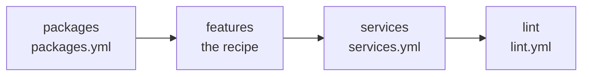

## A small example

```yaml
# syntax=ghcr.io/nomira-os/nomira:sha-…
imports:
  - https://raw.githubusercontent.com/Nomira-OS/arch-base/<commit>/recipes/services.yml
  - https://raw.githubusercontent.com/Nomira-OS/arch-base/<commit>/recipes/lint.yml
settings:
  base: ghcr.io/nomira-os/arch-base:sha-…
  labels:
    org.opencontainers.image.description: My system

build:
  packages: {}            # the phase features comes after packages
  features:
    terminal:
      packages: [kmscon]
      services: [kmsconvt@tty1.service]
      commands:
        - copy files/kmscon/ /etc/kmscon/
    network:
      packages: [networkmanager]
      services: [NetworkManager.service]
      commands:
        - copy --chmod=0600 files/nm/ /etc/NetworkManager/system-connections/
```

Read it like this: there are two features, `terminal` and `network`.
Each says which packages and services it needs and which files it
brings. The [recipe parts](https://github.com/Nomira-OS/arch-base/tree/main/recipes)
of the base image, imported by URL and pinned to a commit, bring the
rest. A part imports what it builds on, so the two imports bring four:

| Part | Brings |
|---|---|
| `mounts.yml` | `settings.mounts`: a tmpfs for logs and temporary files, caches for downloads and the initramfs |
| `packages.yml` | the phase `packages`: every package of every group, as a [collector that fans out](../collectors/#collectors-that-fan-out) |
| `services.yml` | the phase `services`: `systemctl enable` for every unit of every group |
| `lint.yml` | the phase `lint`: `bootc container lint` on the finished system |

The phases then run in this order:



`packages: {}` says where `features` goes: right after `packages`.
Without it, the recipe's own phase would come after all imported ones;
see [Order](../imports/#order). `nomira recipe export` shows the recipe
with everything imported. Which tags to pin: for the
[base image](../base-images/arch-base/versions/#tags) and for the
[frontend](../../frontend/standalone/#tags-of-the-frontend-image); the
parts are pinned to a commit of arch-base.

NetworkManager stands for any network manager here; the Arch Wiki lists
the choices in [Network configuration](https://wiki.archlinux.org/title/Network_configuration).

## Phases

The keys of `build` are the phases; they run in that order. Under a
phase stand its groups, by name, and optionally `env`, the environment
of the phase. A phase with `collect` directly under it is a single
collector named after the phase, see [Collectors](../collectors/).

## Groups

Groups of a phase have names and no order. They are built at the same
time and must not change the same files differently; the build checks
that, see [The conflict check](../../architecture/conflict-check/).

A group has two forms. The short one is a list of commands:

```yaml
network:
  - copy files/nm/ /etc/NetworkManager/system-connections/
```

The long one is a mapping. Two keys have a fixed meaning:

| Key | Meaning |
|---|---|
| `commands` | The list of commands |
| `collect` | Makes the group a collector; then it has no other key |

Every other key, such as `packages` above, is a contribution to the
collector of that name. A group may consist of contributions alone:

```yaml
editor:
  packages: [vim]
```

## The three commands

| Command | Purpose |
|---|---|
| `copy` | Copies files from the recipe directory, or from a stage, into the image |
| `run` | Runs a shell command |
| `env` | Sets a variable for the following commands of the group; a change reruns only those |

Useful additions:

- `copy --chmod=0644` and `copy --chown=0:0` set mode and owner.
- `copy --from=<stage>` copies from a stage, `copy --from=<phase>` from
  the system after an earlier phase.
- `run --mount=type=cache,target=/path` keeps a directory between
  builds.
- `run --no-cache` always runs a step.

## Prefer copy to run

A group that only copies does not look at the system it is applied to,
so nothing that happens before it can make it stale. A group that uses
`run` is executed on the system as it is at that point, and has to run
again whenever that changes, for instance with every new base image.

So the aim is: **`run` belongs in collectors and stages,
groups copy.** What that means for common tasks:

| Task | Instead of `run` in a group |
|---|---|
| Install a package | Contribute it to the `packages` collector |
| Enable a service | Contribute it to the `services` collector |
| Generate a file with a script | Run the script in a stage, copy the result |
| Write a one-line file | Keep the file in the recipe and copy it |

## Where files belong

In the finished system `/usr` is read-only, `/etc` is merged on updates,
and `/var` is not part of the image. Put the content of the system into
`/usr` and `/etc`, not into `/var`, `/opt` or `/usr/local`. The
initramfs follows the packages by itself, see
[The initramfs](../base-images/boot/#the-initramfs).

Every image carries its recipe, resolved, in its label
`org.nomira.recipe`; `nomira recipe export` prints it. See `record` in the
[schema](../../frontend/schema/#settings).

## Build and check

```sh
export NOMIRA_RECIPE="$PWD/recipe.yml"   # or pass -f each time
nomira lint      # check the recipe and its imports
nomira build     # build the image
nomira recipe export "$NOMIRA_RECIPE"    # the recipe with all imports merged
```

All fields and flags are in the [recipe schema](../../frontend/schema/).
